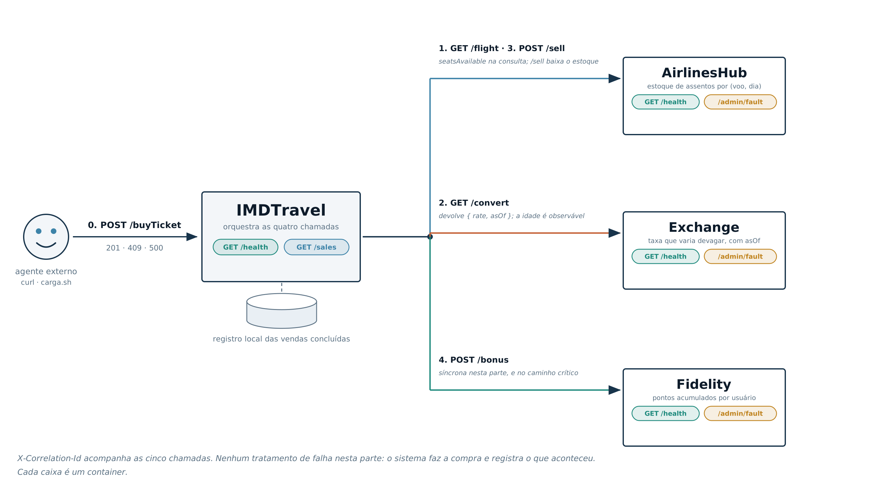

# Especificação do Projeto (Tolerância a Falhas)

**Unidade 2 – Parte 1 · Implementação das estratégias**

|                       |                                                                                                                                     |
|-----------------------|-------------------------------------------------------------------------------------------------------------------------------------|
| **Objetivo**          | Implementar a versão básica do sistema, instrumentá-la e medir como ela se comporta em situações normais e quando as dependências falham.       
| **Equipe**            | Mínimo 2, máximo 3 pessoas. A mesma equipe segue na Parte 2.                                                                        |
| **Entrega**           | Tag BASELINE no repositório e evidências dos testes.                                    |
| **Restrição central** | Nenhum mecanismo de tolerância a falhas nesta parte. O sistema faz a compra, registra o que aconteceu e falha quando tem de falhar. |

> **Primeira de duas partes subsequentes.** Esta parte constrói o sistema sem nenhuma proteção, com as dependências sadias. A [Parte 2](parte2-especificacao.md) parte da versão entregue aqui (tag BASELINE): começa ligando a injeção de falhas nas dependências e medindo o estrago, e depois acrescenta ao IMDTravel a tolerância a falhas.

**Documentos desta parte**

| Documento | Conteúdo |
|---|---|
| [Como executar](../EXECUCAO.md) | O que instalar, como subir e parar os serviços, o catálogo e a configuração. |
| [Como testar](../TESTES.md) | Testes manuais com `curl`, o script `testes.sh` e os testes unitários. |

# 1. O sistema
O sistema simula a venda de passagens aéreas. Um agente externo pede uma compra ao IMDTravel, que orquestra quatro chamadas: consulta o voo, obtém a taxa de câmbio, efetiva a venda e credita o bônus de fidelidade. Cada serviço é um container, e todos sobem com um único comando.

*Figura 1 — Os quatro serviços, as cinco requisições e os endpoints de apoio.*

## 1.1 As cinco requisições
<table>
<colgroup>
<col style="width: 8%" />
<col style="width: 22%" />
<col style="width: 29%" />
<col style="width: 40%" />
</colgroup>
<thead>
<tr class="header">
<th><strong>Nº</strong></th>
<th><strong>Chamada</strong></th>
<th><strong>Entrada</strong></th>
<th><strong>Saída</strong></th>
</tr>
</thead>
<tbody>
<tr class="odd">
<td><strong>0</strong></td>
<td>
POST /buyTicket

→ IMDTravel
</td>
<td>{ flight, day, user }</td>
<td>201 com a compra concluída; 409 se o voo estiver esgotado; 500 se qualquer dependência falhar.</td>
</tr>
<tr class="even">
<td><strong>1</strong></td>
<td>
GET /flight

→ AirlinesHub
</td>
<td>flight, day</td>
<td>{ flight, day, priceUSD, seatsAvailable }</td>
</tr>
<tr class="odd">
<td><strong>2</strong></td>
<td>
GET /convert

→ Exchange
</td>
<td>—</td>
<td>{ rate, asOf }</td>
</tr>
<tr class="even">
<td><strong>3</strong></td>
<td>
POST /sell

→ AirlinesHub
</td>
<td>{ flight, day }</td>
<td>201 { transactionId, seatsRemaining }; 409 quando não há mais assento.</td>
</tr>
<tr class="odd">
<td><strong>4</strong></td>
<td>
POST /bonus

→ Fidelity
</td>
<td>{ user, bonus }</td>
<td>201 { user, totalPoints }</td>
</tr>
</tbody>
</table>

A ordem é obrigatória e as quatro chamadas são síncronas. O valor em reais é o preço em dólar multiplicado pela taxa. O bônus é a parte inteira do preço em dólar.

# 2. Os serviços
## 2.1 AirlinesHub — o serviço que tem estoque
É o único serviço com estado que importa: ele mantém, para cada par (voo, dia), um número de assentos disponíveis. A venda consome um assento, e assento consumido não volta sozinho.

- Catálogo mínimo: 3 voos × 7 dias consecutivos, com exatamente 20 assentos em cada par (voo, dia). O catálogo é recriado a cada subida do container.

- O preço em dólar é determinístico: a mesma consulta devolve sempre o mesmo valor. Preço aleatório por chamada impede comparar duas execuções.

- GET /flight devolve seatsAvailable junto com o preço, e 404 para um par (voo, dia) que não exista.

- POST /sell decrementa o estoque, devolve 201 com um identificador de transação e o estoque restante, e devolve 409 com { error: "sold-out" } quando não há mais assento.

- POST /sell leva de 300 a 900 ms, sorteados por requisição. Um sistema de reservas real não responde em um milissegundo, e o orçamento de tempo da Parte 2 precisa ser discutido sobre números verdadeiros.

- O decremento precisa estar correto sob concorrência: o estoque nunca fica negativo e duas compras simultâneas do último assento não resultam em duas vendas.

## 2.2 Exchange — o serviço cujo dado envelhece
A taxa de conversão não é sorteada a cada chamada: ela é um valor interno que caminha devagar.

- O serviço começa com a taxa em 5,50 e, a cada 10 segundos, aplica uma variação aleatória de até ±0,3%, mantendo o valor dentro da faixa de 5,00 a 6,00.

- GET /convert devolve { rate, asOf }, em que asOf é o instante ISO-8601 da última atualização da taxa.

- Entre duas atualizações, todas as chamadas devolvem o mesmo valor. É isso que torna a idade do dado uma informação com significado.

> Se a taxa fosse sorteada por chamada, um valor guardado há cinco minutos seria estatisticamente idêntico a um recém-obtido, e discutir a idade do dado não faria sentido algum. A caminhada lenta é o que dá conteúdo a essa discussão na Parte 2.

## 2.3 Fidelity — o serviço que não deveria atrapalhar
- POST /bonus acumula pontos por usuário e devolve o total.

- GET /points?user= devolve { user, totalPoints, entries } — é como o roteiro de observação conta quantos bônus chegaram de fato.

- Nesta parte, a chamada ao Fidelity está no caminho crítico: se ela falhar, a compra falha. Esse é um defeito de projeto, e observá-lo é um dos objetivos da Parte 1.

## 2.4 IMDTravel — o orquestrador
- POST /buyTicket executa as quatro chamadas na ordem e devolve 201 com { transactionId, flight, day, user, valueUSD, valueBRL, rate, rateAsOf, bonus }.

- Qualquer falha de dependência produz 500. Nenhum tratamento, nenhuma tentativa adicional, nenhum caminho alternativo.

- Registro local: toda compra concluída é gravada em um arquivo ou tabela dentro de um volume nomeado, com correlationId, transactionId, voo, dia, usuário, valor e instante.

- GET /sales devolve esse registro. É o que permite, no roteiro de observação, comparar o que o IMDTravel acha que vendeu com o que o AirlinesHub realmente descontou do estoque.

# 3. Instrumentação obrigatória
Três itens que custam poucas linhas e sem os quais não há como observar nada. Eles não são tolerância a falhas: são a condição para enxergar o que acontece dentro de quatro containers.

| **Item**            | **O que é exigido**                                                                                                                                                                        |
|---------------------|--------------------------------------------------------------------------------------------------------------------------------------------------------------------------------------------|
| **Correlação**      | O IMDTravel gera um X-Correlation-Id por requisição 0 (ou aproveita o que vier do cliente) e o propaga nas quatro chamadas. Todo serviço registra esse identificador em cada linha de log. |
| **Log estruturado** | Um objeto JSON por linha na saída padrão do container, com no mínimo ts, svc, cid, event e ms. Nada de texto livre: a evidência do relatório sai de docker logs e precisa ser filtrável.   |
| **Sinal de vida**   | GET /health em todos os quatro serviços, devolvendo 200 e { status, uptimeS }. O endpoint precisa verificar alguma coisa de verdade — um 200 fixo não informa nada.                        |

# 4. O que não fazer nesta parte
A lista abaixo não é uma sugestão de simplicidade: é um requisito. A Parte 2 compara o comportamento das duas versões, e meia dúzia de proteções improvisadas aqui tornam essa comparação inútil.

- Não configurar timeout nas chamadas de saída. Usar o padrão da biblioteca HTTP, qualquer que seja ele. O roteiro de observação existe justamente para descobrir qual é.

- Não repetir chamada que falhou, nem uma vez.

- Não implementar caminho alternativo, valor padrão, cache ou resposta degradada.

- Não enfileirar nem adiar nenhuma das quatro chamadas.

- Não limitar requisições simultâneas na entrada.

- Não envolver as chamadas em try/catch que transforme falha em sucesso. Falha de dependência vira 500, e pronto.

> Vale dizer o motivo em voz alta para a turma: o sistema desta parte está certo em relação ao que foi pedido, e ainda assim é frágil. Fragilidade não é desleixo de programação — é uma hipótese que ninguém escreveu.

# 5. Infraestrutura
## 5.1 docker-compose.yml
- Os quatro serviços declarados, um container cada, numa rede interna própria. Apenas a porta do IMDTravel é exposta ao hospedeiro.

- healthcheck em todos os quatro, apontando para o /health de cada um.

- depends_on com condition: service_healthy. Nada de sleep no entrypoint esperando a dependência subir.

- Volume nomeado para o registro local de vendas do IMDTravel.

- O catálogo de voos e assentos do AirlinesHub e a taxa inicial do Exchange vêm de variáveis de ambiente, com o valor visível no arquivo.

- docker compose up precisa bastar. Nenhum passo manual antes, nenhum script de preparação do banco rodado à parte.

# 6. Entrega
- Link do repositório no GitHub, com todo o código, os Dockerfiles e o docker-compose.yml.

- Tag BASELINE marcando esta versão. Ela precisa continuar existindo e funcionando depois da Parte 2 — a comparação depende disso.

- README com: Explicação sobre a Linguagem e Framework utilizados, nomes dos membros da equipe, descrição dos testes realizados, o catálogo de voos usado.

- Evidências dos testes e uma pasta /tests (arquivos de log, mensagens do terminal, etc.)

- Todos os membros com commits distribuídos ao longo do período.
